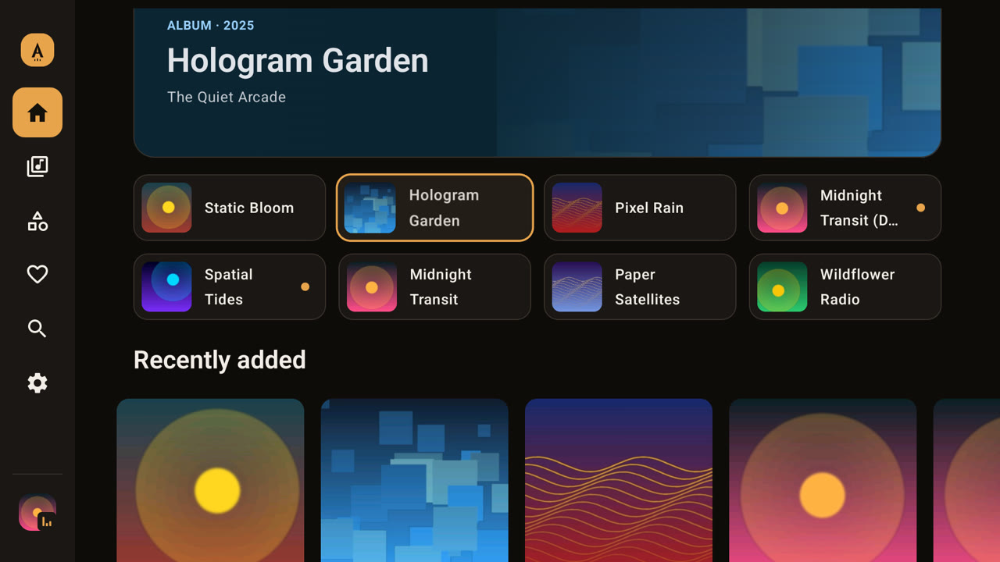
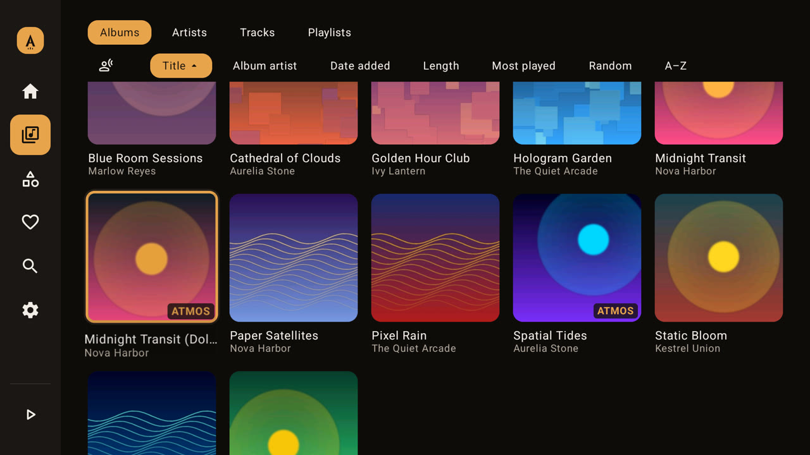
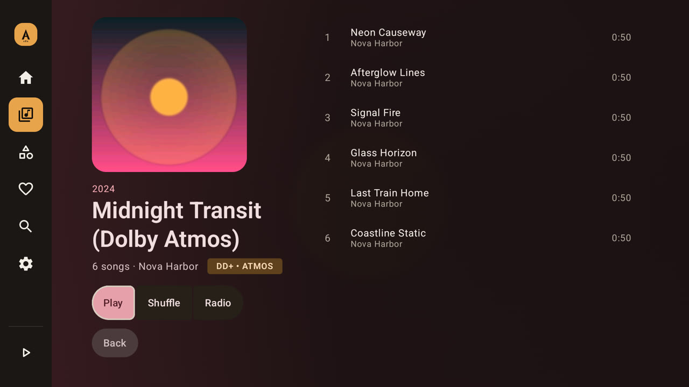
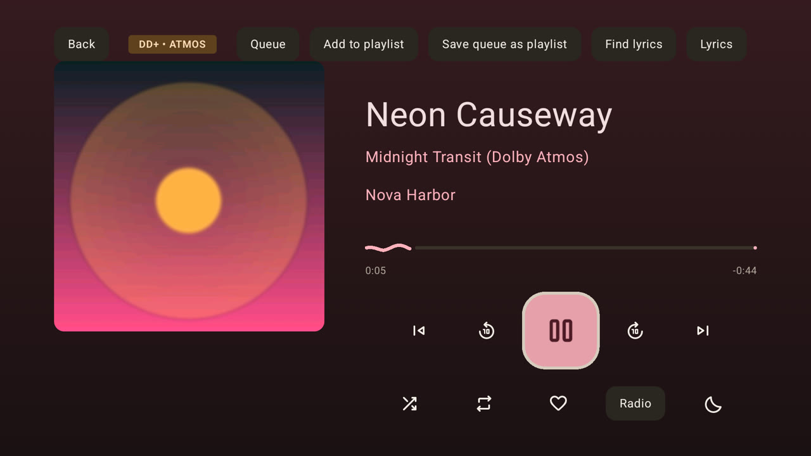
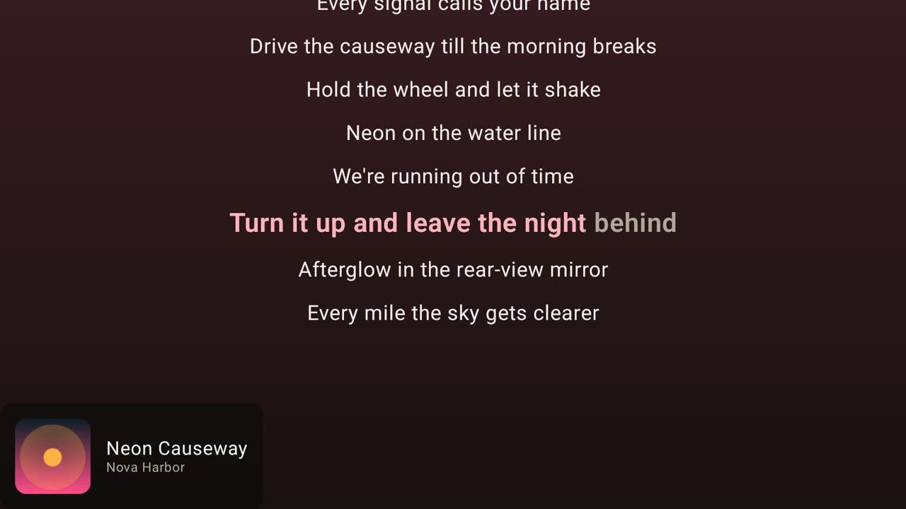
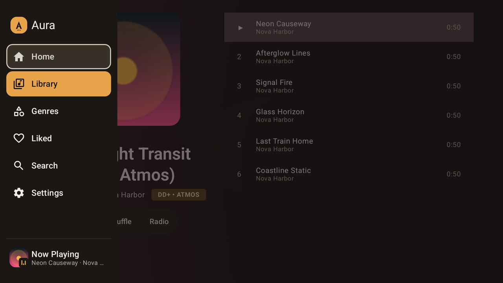
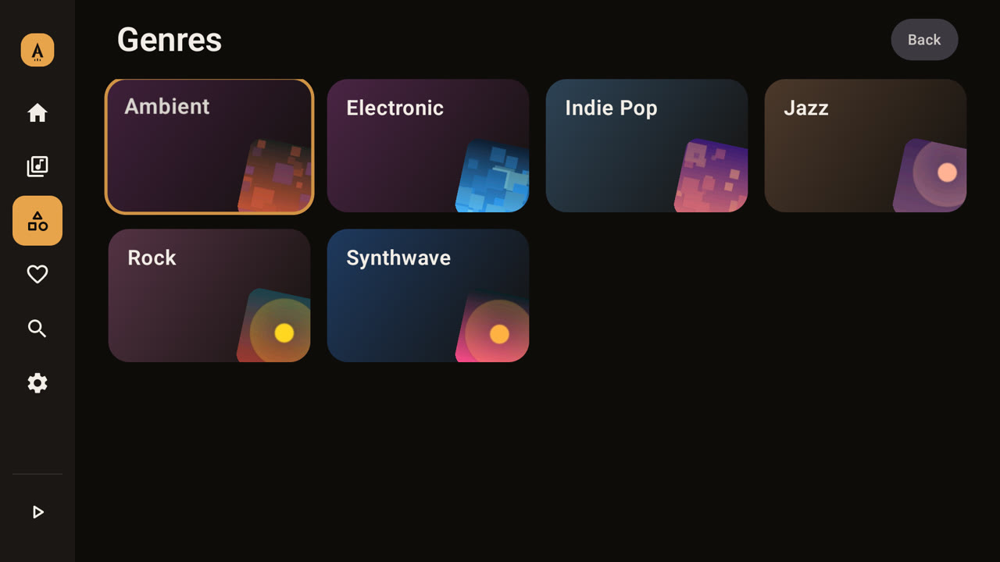

<div align="center">

# Aura

**A native Android TV music player for [Jellyfin](https://jellyfin.org), built around Dolby Atmos.**

Aura streams your Jellyfin music library straight to the living room: E-AC-3 JOC
(Dolby Atmos) is direct-played and bitstreamed to your receiver untouched, and every
screen is designed for a D-pad, a sofa and a 10-foot view.




[Features](#features) · [Getting started](#getting-started) · [Architecture](docs/ARCHITECTURE.md) ·
[Roadmap](docs/ROADMAP.md) · [Aura Remote](https://github.com/gahtv/aura-remote)

</div>

---

## Why Aura

- **Atmos first.** Aura asks Jellyfin for the original file and hands the bitstream to
  Media3, so an Atmos-capable TV/HDMI/AVR chain gets the real thing. No transcoding,
  no in-app volume, no crossfade.
- **Built for the remote.** Focus rings you can see from across the room, BACK that
  returns you to exactly where you were, and no screen that needs a keyboard.
- **Looks like your music.** Artist, album and Now Playing screens take their colour
  scheme from the artwork, and covers glide between screens.

## Features

### Dolby Atmos, clearly marked

Albums and tracks that carry an E-AC-3 JOC stream get an **ATMOS** badge everywhere
they appear: library grids, album and artist pages, genre pages, track rows and Now
Playing. One tap on the Atmos filter shows only Atmos releases, and Home has a
**Your Atmos** shelf. When a library holds both the standard and the Atmos release,
both stay visible; the Atmos one is the badged tile.

| Library with Atmos badges | Atmos album |
|---|---|
|  |  |

### Now Playing and lyrics

A full-screen player with an artwork-tinted background, a seek bar that waves while
music plays, ±10 s jumps, shuffle, repeat, radio, a sleep timer and an "up next" peek.
Lyrics are synced from Jellyfin (LRC, enhanced LRC with word timing, Jellyfin cues or
TTML), with karaoke-style word highlighting, duet colours, translations beneath the
lead line, instrumental-break dots and a per-track timing nudge. Online lookup via
[LRCLIB](https://lrclib.net) is available and off by default.

| Now Playing | Word-synced lyrics |
|---|---|
|  |  |

### Browse the whole library

| Navigation rail | Genres |
|---|---|
|  |  |

- **Home** — a featured album, recently played, recently added, recently played
  artists, Your Atmos, artists and playlists, built from lazy rows.
- **Library** — Albums, Artists, Tracks and Playlists with sort chips, paging, an A–Z
  jump and the Atmos filter.
- **Genres, Liked and Search** — first-class destinations on the side rail. Search
  remembers recent terms and accepts voice input from the remote.
- **Artists** — discography, popular tracks, similar artists and the Jellyfin bio.
- **Radio** — start an instant mix from any track, album, artist or genre; when the
  queue runs out, Aura can keep the music going.

### Living-room comforts

- **Queue you can steer** — reorder, clear upcoming, smart shuffle, resume where you
  left off, sleep timer.
- **Playlists** — create, add, remove and reorder.
- **Sign in from your phone** — Quick Connect shows a code to approve in Jellyfin Web
  or a phone app; switch between saved profiles on the same server from Settings.
- **Choose your libraries** — switched-off libraries are never queried, so their
  music never appears on Home, in search or in the caches.
- **Android TV integration** — a Home-screen channel with recent and Atmos albums,
  system-wide search results, and `aura://item/…` deep links.
- **Remote control** — Aura is a Jellyfin "Play On" target for any Jellyfin client, and
  serves a paired LAN link for **[Aura Remote](https://github.com/gahtv/aura-remote)**,
  a browser remote with queue, lyrics and on-screen mirroring.
- **Fast starts** — library lists and the Atmos catalogue persist in a Room cache
  (24-hour lifetime, refreshable from Settings), and release builds ship a baseline
  profile.

## Getting started

### Requirements

| | |
|---|---|
| Device | Android TV / Google TV, Android 8.0 (API 26) or newer |
| Server | Jellyfin with a music library (developed and tested against 12.x) |
| Atmos | E-AC-3 JOC files (usually `.m4a`) and an HDMI chain that passes Atmos through |
| Build | JDK 17, Android SDK platform 37.1, the bundled Gradle 9.3.1 wrapper |

### Build and install

```bash
export JAVA_HOME=/path/to/jdk-17
export ANDROID_HOME=/path/to/android-sdk

./gradlew :app:assembleDebug     # quick builds for the emulator
./gradlew :app:assembleRelease   # what goes on a real TV (R8 + baseline profile)

adb -s <serial> install -r app/build/outputs/apk/release/app-release.apk
adb -s <serial> shell am start -n com.hans.aura/.MainActivity
```

Release builds are signed with the debug key on purpose, so they install over debug
builds with `adb install -r`. Benchmark and judge playback on release builds; debug
builds are much slower on TV hardware.

The scripts in `scripts/` (`install-emulator.sh`, `deploy-streamer.sh`, `check.sh`)
source `scripts/common.sh`, which hardcodes the author's macOS paths and device serials.
Adjust it before use, or run the Gradle commands directly.

### Sign in

Enter your server address (for example `http://192.168.1.20:8096`) and sign in with a
username and password, or choose **Sign in with a code** to approve the TV from
another Jellyfin client.

### Is Atmos actually reaching my receiver?

Jellyfin showing "Direct Play" only means Aura requested the original file. Whether the
TV passes the bitstream through or decodes it to PCM is decided on the device, so the
receiver's display (Dolby Atmos, not PCM or multichannel) is the final word. Aura's
playback log tag is `AURA_PLAY` (`adb logcat -s AURA_PLAY`). An emulator cannot prove
passthrough.

## Configuration

Aura needs no API keys for Jellyfin. Optional settings live in a gitignored root
`.env`, copied from `.env.example`:

```bash
cp .env.example .env
# LRCLIB_APP_ID=your-app-id   # optional client id sent with online lyrics lookups
```

Each `KEY=VALUE` line becomes a `BuildConfig` string at build time, and builds without
`.env` still compile. Online lyrics lookup is off by default; when enabled it sends
track, artist, album and duration to LRCLIB. Never commit `.env` or put keys in source.

## Development

```bash
./gradlew --max-workers=2 :app:compileDebugKotlin --rerun-tasks
./gradlew --max-workers=2 :app:lintDebug
./gradlew --max-workers=2 :app:testDebugUnitTest
```

Lint runs against a checked-in baseline, so any new lint error fails the build. The
JVM suite (Robolectric where Android is needed, no device) covers the data layer,
lyrics parsing, playback clock and queue rules, focus behaviour and theming.

| Read next | |
|---|---|
| [Architecture](docs/ARCHITECTURE.md) | How the app is wired and the invariants that keep it working |
| [Contributing](CONTRIBUTING.md) | Ground rules, device checks, baseline profile regeneration |
| [Lyrics formats](docs/LYRICS.md) | Supported lyric sources, timing rules and limits |
| [Remote control](docs/REMOTE-CONTROL.md) | Jellyfin remote target and the LAN mirror-link protocol |
| [Roadmap](docs/ROADMAP.md) | What's shipped, what's next, what's out of scope |
| [Release notes](docs/release-notes-main.md) | Notes for the current source version and earlier releases |

## AI usage

Aura was built with AI assistance: an AI agent wrote essentially all of the code under
the author's direction and testing. It works on the author's hardware but has had no
security review. Details in [AI_USAGE.md](AI_USAGE.md).

## License

MIT — see [LICENSE](LICENSE).
