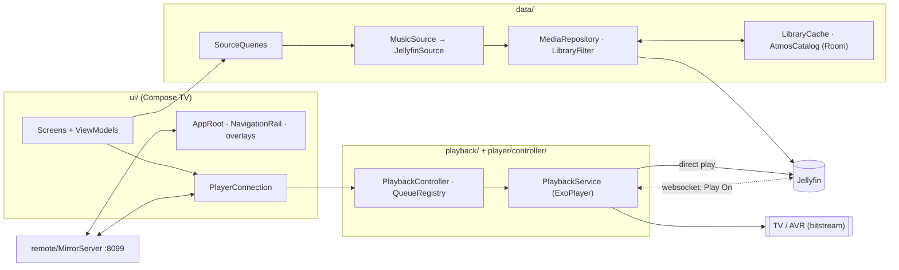

# Aura architecture

How Aura is wired, and the invariants that keep it working on a TV. The
[README](../README.md) is the feature tour; this file is for people changing the code.

**Stack:** Kotlin 2.x · Compose TV + Material 3 (Expressive motion, HCT colour) ·
AndroidX Media3 · Retrofit + OkHttp + kotlinx.serialization · Room · Coil.
`minSdk 26`, `targetSdk 35`, `compileSdk 37.1`. Modules: `:app`, plus `:baselineprofile`,
which generates the app's baseline profile. No DI framework; every dependency version
lives in `gradle/libs.versions.toml`.

## At a glance



**Contents:** [Layers](#layers) · [Composition root](#composition-root) ·
[Library-source seam](#the-library-source-seam) · [Navigation](#navigation-contract) ·
[Motion and transitions](#motion-and-transitions) · [Playback](#playback-pipeline) ·
[Remote control](#remote-control) · [Screen state](#screen-state-and-errors) ·
[Design tokens](#design-tokens) · [Theming](#theming) · [Data and caching](#data-and-caching) ·
[Accounts](#accounts-and-sign-in) · [Android TV integration](#android-tv-integration) ·
[Lyrics, search, discovery](#lyrics-search-discovery) · [Guardrails](#guardrails) ·
[Rules](#rules-that-keep-it-working)

## Layers

```
AuraApp              Application: builds the container, owns the Coil image loader
MainActivity         the only Activity: starts/binds the mirror link, intercepts BACK,
                     defers debug deep links
di/                  AppContainer — the composition root
data/                Jellyfin I/O, caching, preferences, the library source seam
model/               immutable media models used by the UI and player
playback/            MediaSessionService (ExoPlayer) + the Jellyfin websocket
player/controller/   the pieces PlayerConnection coordinates
remote/              the LAN mirror link server and its pairing prompt
search/              Android TV global search provider
tvchannel/           Android TV Home-screen preview channel
ui/                  Compose screens
  nav/               destinations, the back stack, the navigation interface
  shell/             side navigation rail and wiring for mirror, debug and session exit
  common/            shared components, overlays, focus helpers, error pane
  theme/             default and artwork colour schemes, design tokens
util/                AuraLog — the log tag contract
```

### File map

```
AuraApp.kt          builds AppContainer; ImageLoaderFactory (RGB_565, no crossfade)
MainActivity.kt     MirrorLink.start()/bind(), BACK interception, debug-link hand-off

di/AppContainer.kt  Room/CacheDisk; Prefs -> LibraryCache -> AtmosFilter -> MirrorServer
                    -> JellyfinClient -> MediaRepository

data/               JellyfinApi, JellyfinClient (OkHttp + shared Json, one Retrofit per
                    server URL), JellyfinModels (@Serializable DTOs), AuthStore (session +
                    last server, separate keys), Prefs (aura_prefs), LibraryFilter (query
                    construction + hidden-library rules), CacheDatabase (Room), LibraryCache
                    (24h TTL + refresh stamps), PagedLibrary, AtmosCatalog, AtmosBrowse,
                    AtmosFilter, Favorites,
                    Mixes, LyricsStore, Lrclib, DeviceNames, MediaRepository (main-safe
                    browse facade), MusicSource + JellyfinSource (the backend seam),
                    SourceQueries (the browse path screens use)

model/              MediaItem, Track, Album, Artist, Playlist, Genre, Artwork, MediaPage

playback/           PlaybackService (ExoPlayer, AuthDataSourceFactory, PlaybackReporter),
                    PlaybackRemote (capabilities + websocket commands),
                    PausedAudioOutput (releases a paused passthrough AudioTrack)

player/controller/  PlaybackController (MediaController, listeners, PlaybackAnchor clock),
                    QueueRegistry (in-process item registry + queue snapshot),
                    QueueItemLoader, ResumePolicy, AutoplayPolicy, SleepTimer

search/             AuraSearchProvider (system search over the active session)
tvchannel/          HomeChannelPublisher ("Aura — Recent & Atmos" preview channel)

remote/             MirrorServer (HTTP server on :8099, state/navigate/control/input/pair),
                    MirrorPairingDialog (the on-TV allow prompt)

ui/AppRoot.kt       auth gate, destination host over NavState, side rail, overlay hosts
ui/nav/             Destinations.kt (Screen + ScreenMeta + NavSpec), NavActions.kt
                    (NavActions interface, NavState back stack)
ui/shell/           NavigationRail.kt, MirrorWiring.kt, DebugWiring.kt, SessionActions.kt
ui/player/          PlayerConnection.kt — the facade screens talk to
ui/home|library|genres|collection|search|nowplaying|queue|playlist|login|settings/
                    screens; each heavy screen has a paired *ViewModel.kt
ui/common/          Components, PillsAndBadges, FocusSupport, ContextMenu(s), ConfirmDialog,
                    FitText, BioDialog, ErrorPane, NavRequests, SharedArtwork,
                    ConnectedActions, AuraLoadingIndicator, MotionArtwork/MotionWindow
ui/theme/           Theme (static scheme), Dynamic (artwork seed), DynamicScheme (HCT),
                    Tokens (incl. AuraMotion)
ui/AppIntents.kt    parses SEARCH and VIEW intents (aura://item, search results)
ui/MirrorLink.kt    source-compatible shim over remote/MirrorServer
ui/MirrorPairing.kt shim over remote/MirrorPairingDialog
ui/DebugNav.kt      debug-build deep-link channel (FLAG_DEBUGGABLE only)
```

## Composition root

`AuraApp.onCreate` constructs `AppContainer`. The container creates Room's `CacheDatabase`
and its `CacheDisk` adapter, then wires the long-lived stores in dependency order:

1. `Prefs` — file-backed settings; everything else reads it.
2. `LibraryCache` — memory and Room-backed TTL cache whose keys carry the library selection
   `Prefs` owns. `AtmosCatalog` also uses the disk adapter.
3. `AtmosFilter` — mirrors `Prefs.atmosOnly` as Compose state.
4. `MirrorServer` — device name + stored pairing token (needs the application context).
5. `JellyfinClient` — session store + Retrofit; needs readable prefs.
6. `MediaRepository` — main-safe facade over the browse layer, over the client.
7. `JellyfinSource` — the `MusicSource` this build targets, over the client and the
   repository; installed into `MusicSources` right after construction.

`AuraApp.jellyfin` remains as a property that forwards to the container, so screens that
still take `app: AuraApp` compile unchanged. Screens and state holders reach browse data
through `SourceQueries`, not through the repository or `LibraryFilter` directly, so which
backend they are reading stays the container's single decision.

## The library-source seam

Screens and their state holders do not talk to a server. They talk to a `MusicSource`
(`data/MusicSource.kt`), and `SourceQueries` (`data/SourceQueries.kt`) is the only browse
path into it.

The interface is the browse/query surface `MediaRepository` already exposes, plus the one
streaming concern the player has: `streamUri` for the direct-play URL, and `streamTarget`
for that URL together with the headers the request must carry. It is deliberately not a
mirror of the server API — an implementation is a thin adapter over whatever it wraps, and
does not re-derive the caching, filtering or paging rules `MediaRepository` owns.

`JellyfinSource` is today's only implementation: most browse calls forward to
`MediaRepository`, and streaming keeps the two rules the player already relied on
(direct-play URL, `Authorization` header resolved per request from the current
session). `AppContainer` calls `di/BackendFactory.create`, which currently always constructs
`JellyfinSource`; `BuildConfig.MUSIC_SOURCE` defaults to `jellyfin` and is logged, but
changing that field alone does not select a different implementation. `MusicSources.install`
publishes the same instance for call sites outside the graph (the queue builder and playback
service). A new backend needs factory wiring and capability implementations, not
backend-specific browse logic in screens, ViewModels or queue builders.

Unsupported capabilities return empty/null defaults. `SourceQueries.items` returns an empty
`MediaPage` when no source is installed, and `atmosAlbumIds` returns an empty set.
Actual request failures can propagate to the screen state holder and its error pane;
they are not universally swallowed by the source seam.

Album-artist listings now use `SourceQueries.artists` / `MusicSource.artists`, and A–Z
jumps carry `nameStartsWithOrGreater` through `ItemsQuery`.

The source also exposes optional bios, timed lyrics, play history, motion artwork and
catalog import capabilities. Jellyfin supplies bios (HTML stripped from Overview), timed
lyrics and history; it does **not** serve motion artwork or catalog imports. The motion
renderer and its decoder budget are infrastructure, not an animated-cover feature for
the current Jellyfin build. Source caches for bios and lyrics clear on manual refresh;
missing server lyrics are not cached as permanent failures.

### UI model boundary

`data/JellyfinModels.kt` defines the server DTOs; `data/DomainMapping.kt` converts
`JellyfinItem` at the data boundary. `SourceQueries` returns immutable models from
`model/`, including typed `MediaPage` values for browse results. Screens, ViewModels
and navigation use `Track`, `Album`, `Artist`, `Playlist` and `Genre` rather than
reading Jellyfin fields directly. Their list values are not mutated after construction.
Artwork is a backend reference; the data layer resolves it to a URL.

## Navigation contract

`ui/nav/Destinations.kt` holds the single source of truth. Every destination is a case of an
`internal sealed interface Screen`, and every string the app needs about a destination —
saveable-state key prefix, remote vocabulary, debug alias, mirror route, library kind, tab
label, "wraps an item" — lives in its `ScreenMeta` case. `NavSpec` exposes the lookups
(`key`, `mirrorPublish`, `fromMirrorRoute`, `fromDebugScreen`, `isRootRoute`, `takesItem`).

Consequences that are easy to break:

- The three former copies of the string→screen mapping (mirror nav, debug deep links,
  `Screen.key()`) are one table. Adding a screen means adding a `ScreenMeta` entry, not
  three `when` arms.
- Saveable-state keys stay **byte-identical** to the pre-refactor format (`home`, `albums`,
  `col:<id>`, `artist:<id>`, `genre:<name>`); focus restore depends on them.
- `ui/nav/NavActions.kt` defines `NavActions` (back, tab, search, settings, now playing,
  queue, genres, genre, collection, artist) and `NavState`, which owns the stack,
  `pendingFocus` (set on push so a new screen claims focus) and `focusTick` (bumped on pop
  so the revealed screen pulls focus back into content). Screens receive individual
  callbacks from `AppRoot`; nothing navigates by calling a global.

`ui/AppRoot.kt` is the shell: auth gate, the destination host, the side navigation rail
and the overlay hosts. `NavigationRail.kt` replaces the top bar: it expands when focused,
offers root destinations, Search and Now Playing, and shows the current track when one
is available. It is hidden on Now Playing and while a full-screen overlay is open.
The non-screen wiring sits beside it in
`ui/shell/`: `MirrorWiring` (publish state, honour remote navigation), `DebugWiring` (the
debug extras) and `SessionActions.endSession` (session teardown).

BACK is intercepted in `MainActivity.dispatchKeyEvent` (`ACTION_DOWN`, `repeatCount == 0`)
because Compose focus groups consume it as "move focus out" before any `BackHandler` runs.
The dispatcher then routes to the enabled `BackHandler` (return from the expanded rail
to content, pop, dismiss overlay, or go from a root tab to Home) or the default exit on Home.

Screen state survives BACK via `rememberSaveableStateHolder().SaveableStateProvider` keyed
by stack index + `NavSpec.key`. Exact-focus restore is a second layer: `FocusKeeper`
(`ui/common/FocusSupport.kt`) holds per-item `FocusRequester`s, each card/row reports the
focused id via `onFocused`, and `RestoreFocusOnBack` waits until the active destination
has focusable content. It requests the saved item on a frame, falling back to the container
when the target is unavailable.

`OverlayVisibility.dialogOpen` is set while a full-screen overlay is composed; it suppresses
the navigation rail so it cannot draw over (and take focus from) a dialog. Overlays are the
last child of a screen-root `Box`, trap focus with `FocusRequester.Cancel`, and request focus
shortly after composition.

## Motion and transitions

`AuraMotion` (`ui/theme/Tokens.kt`) wraps `MotionScheme.expressive()`: spatial springs
for position, size and shape, effect springs for colour and alpha, and the shared focus
scale for artwork cards. Use it instead of one-off `tween`s.

`AppRoot` hosts destinations inside `SharedTransitionLayout` + `AnimatedContent`, so the
artwork that was selected (a Home tile, a grid cell) morphs into the album/artist header
or Now Playing cover. `ui/common/SharedArtwork.kt` scopes this: only the selected
occurrence carries the shared key, corner radii are interpolated per pair, and a
destination does not accept focus until its entry is visible.

Lists are lazy (`LazyColumn`/`LazyRow` with stable keys and content types), focus scale
is applied in `graphicsLayer` so a D-pad move does not recompose cards, and focus
hand-off is layout-driven rather than timer-driven.

## Playback pipeline

`PlayerConnection` is the facade every screen and the mirror link talk to. It owns the
`StateFlow`s (current item, queue, index, isPlaying, position, duration, shuffle, repeat,
sleep remaining, smart shuffle) and delegates:

| Piece | Responsibility |
|---|---|
| `PlaybackController` | builds the `MediaController` against `PlaybackService` through a `SessionToken` (connecting is what brings the service up), forwards listeners and re-anchors the playback clock on every play/pause/seek/transition. All Media3 access is main-thread. |
| `PlaybackAnchor` | one immutable sample (position, speed, playing, monotonic uptime). `rememberPlaybackPosition` interpolates it on frames only while playing, so the seek bar, karaoke words, adlibs and break dots share one phase-locked clock and nothing recomposes a whole screen on a timer. |
| `QueueRegistry` | In-process `Track` metadata keyed by media ID, the queue id snapshot the "re-tap the playing row opens Now Playing" rule reads, and `normalOrderIds` for undoing smart shuffle. |
| `ResumePolicy` | local resume points (30-day TTL) and the "past 15 s, not within 10 s of the end" rule. |
| `AutoplayPolicy` | appends an Instant Mix on `STATE_ENDED` with repeat off. |
| `SleepTimer` | countdown; expiry pauses and leaves the queue intact. |

`PlaybackService` owns ExoPlayer, constructs `PlaybackReporter` and `PlaybackRemote` in
`onCreate`, pins `player.volume = 1f` on construction and on every item transition, and
builds its `DataSource` through `AuthDataSourceFactory`, which resolves the Jellyfin
`Authorization` header from the live `AuthStore.session` + `BuildConfig.VERSION_NAME` on
**every** `createDataSource()` call. Baking the header once in `onCreate` left streams on the
old server's token after a sign-in change.

`PausedAudioOutput` stops the player shortly after a pause on encoded passthrough audio
(E-AC-3/JOC, AC-3, AC-4, DTS, TrueHD).
Media3's `pause()` keeps a passthrough `AudioTrack` open, which holds the TV's HDMI
output and degrades other apps; resume paths must therefore prepare again from
`STATE_IDLE`.

Media3 `MediaItem`s carry the media ID, stream URI and basic display metadata. The full
domain `Track` lives in `QueueRegistry`. If remote playback ("Play On") supplies an
unknown ID, `syncItem` resolves it rather than assuming the queue was started locally.

Streams are direct-played: no transcoding, no decoding in-app, so the E-AC-3 JOC bitstream
reaches the AVR untouched. Volume is therefore not an app concern — `SetVolume` is absent
from advertised capabilities, inbound volume commands are logged and dropped, and playback
reports carry `VolumeLevel = 100`.

Capabilities are declared **twice** — `CapabilitiesDto` in `data/JellyfinModels.kt` and a
hand-built JSON body in `playback/PlaybackRemote.kt`. Change both together or the server
advertises a command Aura no longer honours.

### Queue behaviour

`playQueue(items, startIndex, playWhenReady, resume)` is the single entry point. Callers state
intent: a row tap passes `resume = true`, Play/Shuffle/Radio pass `resume = false`. Tapping
the row that is already playing from the same queue opens Now Playing instead of restarting;
the check compares the tapped ids to the live queue as a multiset plus the registry snapshot,
so a reorder does not turn the tap into a restart while a remote Play Next still falls back to
the strict comparison.

Mutations (`moveInQueue`, `clearUpcoming`, `removeFromQueue`, remote Play Next/Last) run on
the main thread, keep the snapshot in step, and let `onTimelineChanged` republish the mirror —
the queue screen renders the player's real order, never a separate list.

- **Resume** — positions are remembered locally (`Prefs.ResumePoints`, keyed per server
  and user so household profiles never share bookmarks) because Jellyfin 12.2.0 never writes `UserData.PlaybackPositionTicks` from the report endpoints.
- **Autoplay** — on `STATE_ENDED` with repeat off and the preference on, an Instant Mix
  seeded from the last track is appended (up to 20 new ids). Not gated on `playWhenReady`:
  a player that just finished reports it false, and gating on it silently killed the queue.
- **Smart shuffle** — a pure function over the items after the current one, so the playing
  track and its position are untouched and the original order can be restored.
- **Sleep timer** — expiry pauses; the control lives on the queue screen.

## Remote control

`remote/MirrorServer` is the LAN HTTP server on port 8099 (`GET /state`, `POST /navigate`,
`/control`, `/input`, `/pair/request`, `GET /health`). Pairing is USB-debugging style: the
first request shows an allow/deny prompt on the TV and only Allow mints the `X-Aura-Token`
every other endpoint requires. The protocol is specified for external consumers in
`docs/REMOTE-CONTROL.md`.

`ui/MirrorLink.kt` is a delegating shim kept so existing call sites (`MainActivity`,
`AppRoot`, `NowPlayingScreen`) did not have to move with the package; new code should talk to
`MirrorServer` directly. Player state and commands go through
`MirrorLink.bindPlayer`/`MirrorServer.bindPlayer` and must run on the main thread — Media3
throws from an HTTP worker, and the request hangs instead of answering.

`ui/shell/MirrorWiring.kt` is the only place the app publishes what it is showing
(`NavSpec.mirrorPublish`) and the only place remote navigation is applied
(`NavSpec.fromMirrorRoute`): root routes replace the stack, Now Playing / Queue push, and
album/artist routes fetch the item first.

## Screen state and errors

Heavy screens own a `ViewModel` (Library, Home, Collection, Artist, Genres + GenreAlbums,
Search) with a `StateFlow` of a state data class. `AppRoot` supplies a session-scoped
`LocalViewModelStoreOwner` backed by an Activity ViewModel, so screen models survive
Activity recreation but are cleared on profile switch, sign-out, or final Activity
destruction. Explicit keys such as `"library:$kind:$userId"` and `"collection:$id:$userId"`
keep different tabs and items from reusing each other's state within that session.

Failures reach the user as `UiError` state rendered by `ui/common/ErrorPane.kt` (message +
Retry) on Home, Library, Collection, Artist, Genres and Search. The logging stays: a screen
that fails shows a retry affordance instead of an empty grid.

## Design tokens

`ui/theme/Tokens.kt` is the 10-foot scale: `AuraColors` (cursor ring, focused fill, scrims,
text roles), `AuraSpacing` (4/8/12/16/24/32/48), `AuraTypography` (~8 sizes), `AuraShapes`,
`AuraSizes` (card sizes, minimum focus target and other TV dimensions). Shared Material 3
typography and semantic corner shapes style controls, cards and dialogs.

## Theming

Two colour sources, deliberately split:

- **Static scheme** (`ui/theme/Theme.kt`) — the default for the shell and browse UI.
- **Artwork scheme** (`ui/theme/Dynamic.kt`, `DynamicScheme.kt`) — the featured Home card,
  artist and collection details, and Now Playing use a scoped `AuraDynamicTheme`.
  Coil decodes a 96 px image, Material Color Utilities quantizes and scores its pixels,
  and `ArtworkSeedCache` caches the seed process-wide by artwork URL. The HCT seed
  (hue, chroma, tone) generates a dark Tonal Spot scheme. Changes animate between colour
  roles, and both Compose and TV Material 3 themes receive the scheme. Without a seed,
  the subtree uses the default scheme.

## Data and caching

`SourceQueries` is the only browse entry point screens use. It asks the configured
`MusicSource`, which in this build is `JellyfinSource` -> `MediaRepository` ->
`LibraryFilter.queryItems`: with nothing hidden that passes straight through to a single
query, and with a hidden set it issues one recursive `ParentId` query per visible library
and merges pages client-side. Music item types only fan out into libraries whose
`CollectionType` is `music` or unknown (a movies/playlists root *does* return music items,
which is how albums survived with every music library switched off). Direct lookups
(`getItem`, `/Items?Ids=`, playlist items, the "Play On" path) are exempt. Every cache key
carries `LibraryFilter.cacheSuffix()`.

`LibraryCache` checks memory first, then restores unexpired browse lists from Room's
`library_lists` table in `aura-cache.db`. The 24-hour TTL applies to both tiers. A miss
can be refetched and cached; affected keys must be evicted on server mutations.
**Refresh library now** in Settings clears cached lists and triggers screen reloads.

Large lists use 60-item pages, mapping Jellyfin's `TotalRecordCount` to the domain
`MediaPage.total`. `PagedLibrary` holds browse state in-process.

`AtmosCatalog` scans the audio library when it has no valid cached result and caches album
and track IDs containing an E-AC-3 JOC stream in memory and Room's `atmos_catalogs` table.
The result feeds the ATMOS badges, the per-view
`AtmosFilterPill` and `Prefs.atmosOnly` via `AtmosFilter.keep`. Queues, Now Playing and
playlist contents are never filtered. Album dedupe is not a thing: the FLAC and Atmos copies
of a release are two tiles, and "Only Atmos" is a filter, never a dedupe rule.

All app preferences live in `aura_prefs` (`Prefs`); the session lives in `aura_session` and
cache stamps in `aura_cache`. Mirror pairing has its own `aura_mirror` token store.

## Accounts and sign-in

`AuthStore` keeps the session and the last server address apart. "Sign in again" drops only
the token; "Change server" drops both. `JellyfinClient.api` is a **getter** keyed by base URL
— Retrofit instances are bound to a URL, so a server change must rebuild it.

Two sign-in paths end in `AuthStore.save`: password (`POST /Users/AuthenticateByName`) and
Quick Connect (initiate, poll every 2 s, `POST /Users/AuthenticateWithQuickConnect`). Quick
Connect runs **before** a session exists, so it goes through
`JellyfinClient.apiForServer(url)` — the `api` getter would resolve from the session and point
at localhost.

`AuthStore` also keeps every saved profile per server. Settings > Profiles switches with
`switchProfile`, which installs that user's saved session on the same server.

Every exit path funnels through `ui/shell/SessionActions.endSession`, in this order: stop
playback and release the controller (which stops `PlaybackService`), clear the player
registry and session caches (including `LibraryCache`, `PagedLibrary`, `AtmosCatalog` and
`ArtworkSeedCache`), then drop the credentials. Getting the order wrong leaves the old
server streaming under a login screen, or resolves new-server item ids against old-server
metadata.

## Android TV integration

- **Home-screen channel** — `HomeChannelPublisher` publishes "Aura — Recent & Atmos"
  through `TvContract` preview programs (needs `WRITE_EPG_DATA`). Calls are wrapped in
  `runCatching`, so non-TV devices and Robolectric fail silently.
- **Global search** — `AuraSearchProvider` answers the launcher's search with results
  from the active Jellyfin session; with no session it returns nothing.
- **Intents** — `AppIntents` turns `ACTION_SEARCH` into the Search screen and
  `ACTION_VIEW` (`aura://item/...`, search-result content URIs) into an item route.
  Channel programs and search results open through these.
- **Debug deep links** — debuggable builds accept `--es aura_debug_screen <alias>` plus
  the extras documented in `ui/DebugNav.kt`; aliases come from `ScreenMeta.debugAlias`.

## Lyrics, search, discovery

`LyricsStore` and `TtmlLyrics` parse lyrics; `LyricsPane` owns top-anchored auto-scroll, a 4 s auto-follow pause on
manual scroll, and per-track timing nudges stored as `lyrics_offset_<trackId>`. When Jellyfin
has nothing and the setting is on, `Lrclib` queries `lrclib.net/api/get` (fallback
`/api/search`) identifying itself with a versioned client header and, when configured,
`Lrclib-App-Id` from `BuildConfig.LRCLIB_APP_ID` (root `.env`, never in source);
hits and misses are cached, errors are not.

`LyricsStore.pairSameStampTranslations` groups adjacent same-stamp LRC source rows
before offset clamping and sorting, retaining repeated-stamp copies and timed
translation segments. Cue-only/inline-only Jellyfin lines without `Start` do not pair.
`LyricLine.endMs` / `TimedLyricLine.endMs` carry explicit line ends from TTML,
Jellyfin cues or enhanced LRC; `foldBlankLines` folds blank synced rows into the
previous line's end. `lyricBreaks` requires a gap of at least 4 seconds after all
earlier vocals (including timed adlibs) end. `LyricsPane` gives the active break's
non-focusable dots the current-line scroll anchor and removes current-line styling
from the ended lyric. See [lyrics formats and timing](LYRICS.md) for edge cases.

Search runs one query with `IncludeItemTypes=Audio,MusicAlbum,MusicArtist,Playlist` and splits
results client-side into three stacked shelves — no tabs. The field auto-focuses on entry,
ENTER and ImeAction submit without dropping focus, recent terms live in `Prefs`, and the mic
button fires `RecognizerIntent` behind a `resolveActivity` check.

Genres are built from the `Genres` field of the library's own tracks, not the server's
`MusicGenre` table (that table keeps every genre the library ever saw, and `Genres=` compares
the full string). A–Z uses `nameStartsWithOrGreater` and is SortName+Ascending only, so
picking any other sort or filter clears the letter first.

## Guardrails

- `gradle/libs.versions.toml` — every dependency coordinate; no versions in the module file.
- `app/lint-baseline.xml` + `abortOnError = true` — existing findings are frozen, a **new**
  lint error fails the build. Shrink the baseline over time rather than fixing 200 findings.
- `scripts/check.sh` — the one command that must be green before anything lands:
  `:app:compileDebugKotlin --rerun-tasks` (without `--rerun-tasks` Gradle can report
  UP-TO-DATE and not compile the edit at all), then `:app:lintDebug`, then
  `:app:testDebugUnitTest`. Never installs, never touches a device. It sources
  `scripts/common.sh`, whose hardcoded macOS JDK/SDK paths must be adapted elsewhere;
  the README provides equivalent direct Gradle commands.
- JVM tests (`app/src/test/`, ~80 files) cover the data layer (`LibraryFilter`,
  `LibraryCache` + Room persistence, `AtmosCatalog`/`AtmosFilter`, `DomainMapping`,
  `AuthStore`, `Prefs`, source routing), lyrics (LRC, TTML, word timing, breaks, LRCLIB),
  playback (`PlaybackAnchor`, `PausedAudioOutput`, queue loading and ordering), focus and
  layout behaviour per screen, the mirror server, TV channel and search provider, and
  theming. Robolectric supplies Android context where needed; no device is required.
- `util/AuraLog.kt` — `AuraTag` is the enum of log tags (`AURA_NAV`, `AURA_MENU`,
  `AURA_QUEUE`, `AURA_MIRROR`, …). The tags are the headless verification harness, so they
  are a contract, not decoration. Not every call site has migrated yet; the tags themselves
  must not change.

## Rules that keep it working

- ExoPlayer access from **any** non-main context throws. Read player fields on the main
  handler tick, snapshot them, and pass the snapshot into coroutines — including websocket
  callbacks and HTTP workers.
- The shared `Json` sets `encodeDefaults = true`; otherwise defaulted request fields are
  omitted and the server resets its state (this silently broke remote seek).
- Retrofit methods returning `Response<T>` do not throw on 4xx/5xx. Check `isSuccessful`
  before treating a mutation as done.
- A playback stop report must carry the **old** item's position. When the id changes the
  player has already moved on, so `currentPosition` is 0:00 and every skipped track would be
  saved at zero.
- Jellyfin 12.2.0 does not persist playback positions from the report endpoints; anything
  that needs a resume point must store it locally.
- All TV text fields: `singleLine = true` + `KeyboardOptions` imeAction. A material3
  `TextField` in a TV dialog consumes D-pad direction keys, so DOWN-to-buttons needs an
  explicit `onPreviewKeyEvent` mapping.
- `.onFocusChanged {}` must precede `.clickable {}` / `.focusable()` in the modifier chain,
  or the focus flag never flips and focused styling never renders.
- A control nested inside a focusable card/row is unreachable by D-pad (focus search does not
  descend into a clickable parent). Make such a control an indicator and put the action in
  the context menu or in a real button row.
- A `MutableStateFlow` collected without `.drop(1)` replays its current value. That is how a
  0-valued "open Now Playing" counter pushed the screen on every cold start.
- The deployed artifact is the **release** build (R8 minification and resource shrinking)
  — debug builds are markedly slower on TV hardware and are only for emulator UI
  iteration. R8 needs the keep rules in `app/proguard-rules.pro` for the reflective surface
  (Retrofit interface, DTOs and their `$$serializers`, media3); after every release build,
  smoke-test the launch and grep logcat for `FATAL`.
- Secrets (LRCLIB client id, any future key) come from the root `.env` via
  `buildConfigField`; `.env` is gitignored and `.env.example` documents each key. Builds
  without `.env` must still compile, so every generated field has a default.
- Coil decodes artwork as `RGB_565` with a 20% memory-cache cap and no crossfade, set once in
  `AuraApp.newImageLoader`.
